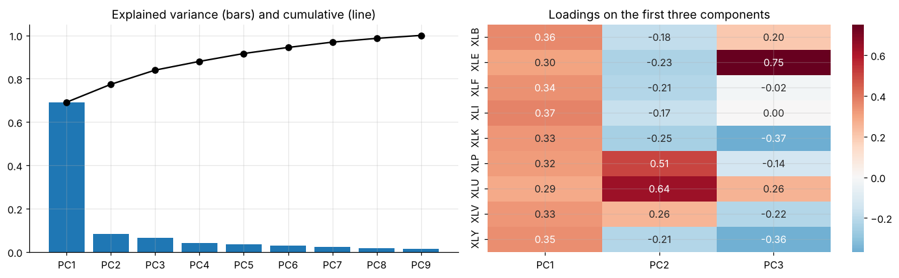
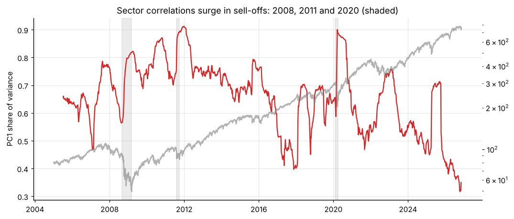
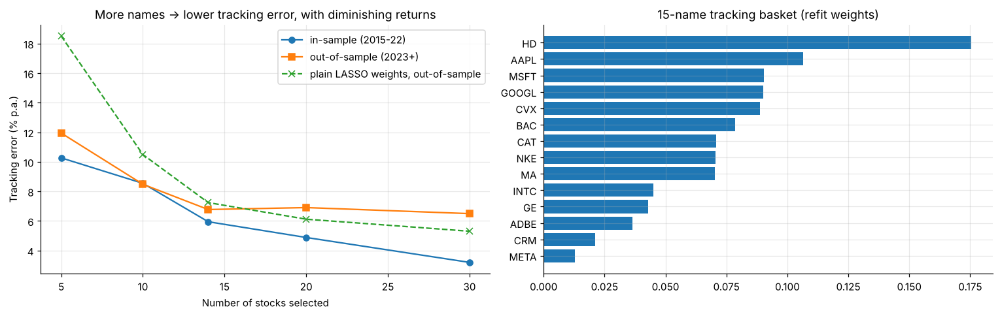

# Machine Learning for Finance: PCA, LASSO and Tree Models

Three applied machine-learning studies on market data. Each is evaluated **out-of-sample** and reported as measured, including where the models fail.



## Studies

| # | Notebook | Method | Main result |
|---|---|---|---|
| 1 | [PCA factor models](notebooks/01_pca_factor_models.ipynb) | PCA on 9 sector ETFs (2005-2026), rolling absorption ratio | PC1 = market (69% of variance, 0.97 correlation with SPY); PC2 = defensive vs cyclical; PC3 = commodity. Coupling surges in sell-offs |
| 2 | [LASSO index tracking](notebooks/02_lasso_index_tracking.ipynb) | Two-stage tracker: LASSO selection + minimum-tracking-error refit | Refit beats plain LASSO weights for small baskets (5 names: 12% vs 19% out-of-sample TE); diminishing returns past ~15 names |
| 3 | [Tree models for regimes](notebooks/03_tree_models_market_regimes.ipynb) | Logistic, decision tree, random forest, gradient boosting; expanding walk-forward | **No out-of-sample skill** (AUC < 0.5) despite in-sample AUC up to 0.97, a clear demonstration of overfitting |

<p float="left">
  
  
</p>

## Why the negative result is included
Notebook 3 is deliberately part of the portfolio. Random forests and boosting reach **0.97 AUC in-sample** and **0.41 out-of-sample** on the same features. Detecting that gap before money is at risk is what disciplined model validation is for.

## Quick start

```bash
git clone https://github.com/drimranbhatti/ml-finance-models.git
cd ml-finance-models
pip install -e ".[notebooks,dev]"
pytest                          # 6 tests
python scripts/fetch_data.py    # optional: refresh data snapshots
jupyter lab notebooks/
```

```python
from finml import factors, tracking, regime
model = factors.fit_pca(sector_returns)               # loadings, explained variance, factor returns
w, alpha = tracking.sparse_tracking_portfolio(stock_returns, spy_returns, n_names=15)
p_up = regime.expanding_walk_forward(clf, features, target, min_train=60, step=12)
```

## Package
`src/finml/`: `factors` (PCA, absorption ratio) · `tracking` (LASSO path selection, constrained refit, tracking error) · `regime` (monthly macro features, walk-forward classifier, scores)

## Data
Daily adjusted closes from Yahoo Finance (snapshots in `data/`): 9 SPDR sector ETFs, 40 US mega-caps, and SPY / VIX / Treasury yields / HYG / IEF / GLD / UUP.

## References
Kritzman, Li, Page & Rigobon, *Principal Components as a Measure of Systemic Risk* (2011) · Tibshirani, *Regression Shrinkage and Selection via the Lasso* (1996) · Breiman, *Random Forests* (2001) · Friedman, *Greedy Function Approximation* (2001)

---
**Author:** Dr. Muhammad Imran Bhatti, PhD (Finance), MScFE · FCMA · [LinkedIn](https://www.linkedin.com/in/drimranbhatti) · [imranbhatti.com](https://imranbhatti.com)

*Built on my MScFE machine-learning-in-finance coursework (WorldQuant University) and rewritten as standalone studies. Research only; not investment advice. MIT licensed.*
